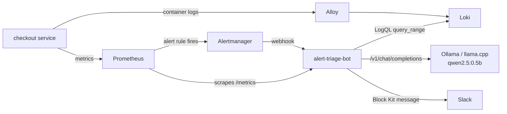

# alert-triage-bot

When Prometheus fires an alert, this service pulls the matching error logs from Loki, asks a
**self-hosted LLM** for a likely cause, and posts both to Slack. The on-call engineer opens the alert and
already sees what the logs say, instead of starting from a bare "5xx rate above 5%".

No data leaves your cluster: the LLM is any OpenAI-compatible server you run yourself
(Ollama, llama.cpp server, vLLM).



## What it does

| Situation | Behaviour |
|---|---|
| Alert fires | Reply `202` at once, then in the background: Loki logs → LLM summary → Slack |
| Alertmanager retries or re-sends | De-duplicated by `fingerprint` + status (default 1 h) |
| Several alerts in one webhook | Each handled separately |
| Alert resolves | Short "resolved" message, no Loki or LLM call |
| Loki down or no logs | LLM still runs on the alert alone |
| LLM down or slow | Slack still gets the alert + raw logs + "No AI summary (reason)" |
| Slack down | Logged and counted in metrics; the service keeps running |

Log lines are normalised before the LLM sees them: timestamps are stripped and JSON logs become compact
`key=value` text, so 40 copies of the same error become one line ending in `(x40)`. This matters because a
0.5B model has a small context window.

The webhook replies before doing the slow work because a CPU-only LLM takes 10–60 s, and Alertmanager
retries on timeout, which would post duplicates.

## Run it locally

Needs Docker and ~2 GB free RAM. The model (~400 MB) downloads on first start.

```bash
make up                                  # Prometheus, Alertmanager, Loki, Alloy, Ollama, demo app, bot
make demo-incident MODE=payment_timeout  # or db_pool, bad_config
make logs                                # the Slack message is printed here (DRY_RUN=true)
make recover
```

To post to a real Slack channel: `SLACK_WEBHOOK_URL=https://hooks.slack.com/... DRY_RUN=false make up`.
Grafana (optional): `docker compose --profile ui up -d`, then http://localhost:3000.

The demo `checkout` service generates its own traffic and has three failure modes, each with different
log lines: `payment_timeout`, `db_pool`, `bad_config`.

## Results

<!-- RESULTS -->

## Deploy to Kubernetes

```bash
kubectl create secret generic alert-triage-bot \
  --from-literal=SLACK_WEBHOOK_URL=https://hooks.slack.com/... \
  --from-literal=WEBHOOK_TOKEN=$(openssl rand -hex 16)
helm install alert-triage-bot charts/alert-triage-bot \
  --set secret.existingSecret=alert-triage-bot \
  --set config.lokiUrl=http://loki-gateway.monitoring.svc \
  --set config.llmBaseUrl=http://llama-server.llm.svc:8080/v1 \
  --set serviceMonitor.enabled=true
```

The pod runs as non-root with a read-only root filesystem and all capabilities dropped. Keep one replica:
de-duplication is in memory.

## Configuration

All settings are environment variables (see `src/triage/config.py`).

| Variable | Default | Notes |
|---|---|---|
| `LOKI_URL` | `http://loki:3100` | |
| `LLM_BASE_URL` | `http://ollama:11434/v1` | Any OpenAI-compatible API |
| `LLM_MODEL` | `qwen2.5:0.5b` | |
| `LLM_TIMEOUT` | `90` | Seconds |
| `LLM_CONCURRENCY` | `1` | Parallel LLM calls; extra alerts wait |
| `SLACK_WEBHOOK_URL` | unset | Unset or `DRY_RUN=true` prints to stdout |
| `WEBHOOK_TOKEN` | unset | If set, requires `Authorization: Bearer <token>` |
| `LOG_LOOKBACK_MINUTES` | `10` | Log window before the alert's `startsAt` |
| `MAX_LOG_LINES` / `MAX_LOG_CHARS` | `30` / `3000` | Budget for the LLM prompt |
| `DEDUPE_TTL_SECONDS` | `3600` | |

## Metrics

`triage_alerts_received_total{status}`, `triage_alerts_duplicate_total`,
`triage_alerts_processed_total{status,outcome}`, `triage_dependency_errors_total{target}`,
`triage_llm_request_seconds`, `triage_processing_seconds`.

## Development

```bash
uv sync
make test   # pytest + coverage; Loki, LLM and Slack are mocked with respx
make lint   # ruff
```

## Problems hit while building

- **Alloy missed two containers.** With every container starting at once, Alloy's first Docker discovery ran
  while `checkout` and `bot` were still being created. It never tailed them, so Loki had logs from every
  service except the two that mattered. I found it by comparing `loki_distributor_lines_received_total`
  with the expected log volume. Fixed with `depends_on` so Alloy starts last.
- **Repeat-collapsing did nothing on real logs.** The unit tests used plain log lines. Real JSON logs carry a
  timestamp, so every line was unique, and the model got 10 copies of one error instead of 10 different
  clues. Fixed by normalising lines (strip timestamps, JSON → logfmt) before comparing.
