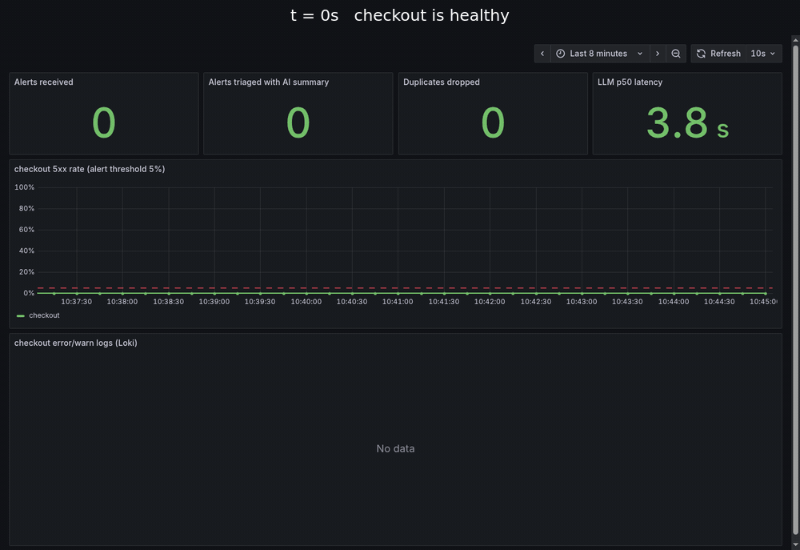
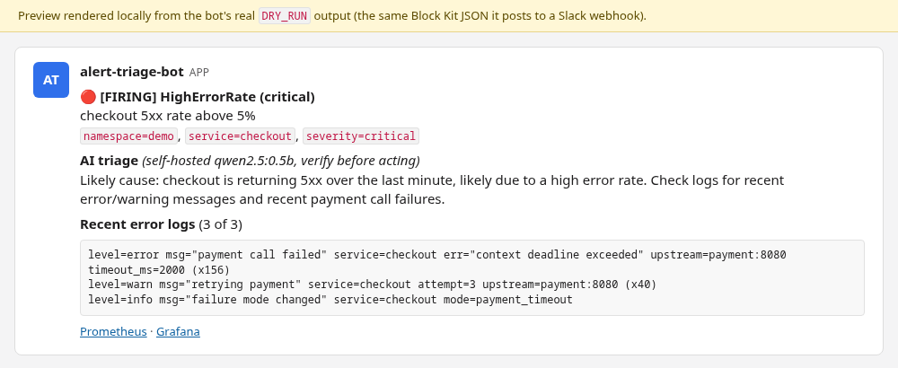
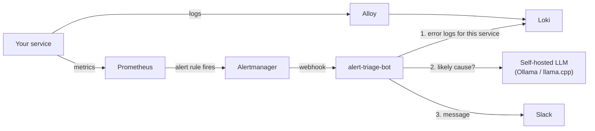
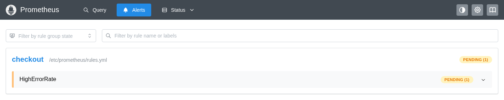
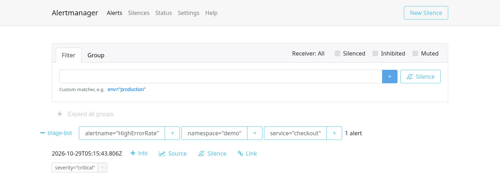
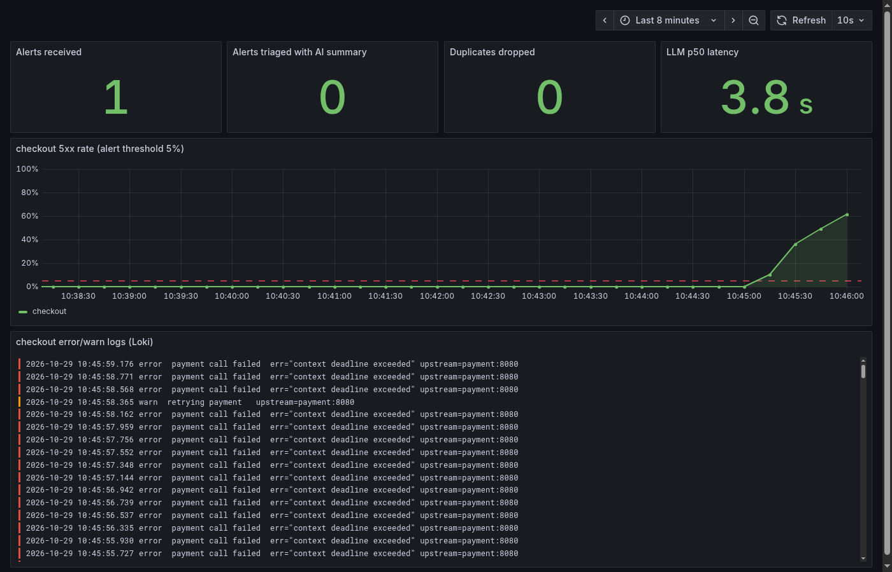

# alert-triage-bot

[](https://gitlab.com/spandanmandal/alert-triage-bot/-/pipelines) [](https://gitlab.com/spandanmandal/alert-triage-bot/-/pipelines)

**When a production alert fires, this bot reads the logs for you and posts a first diagnosis next to the alert.**



*Real run on a laptop, 65 seconds from the first failed request to the message. Most of that is the alert rule's
deliberate 30 s wait; the bot's own work took 6 s.*

## The problem it solves

A typical alert says only *"checkout 5xx rate above 5%"*. The on-call engineer then spends the first few minutes
of the incident opening Grafana, finding the right service, and searching logs to see *what* is failing.

This bot does that first step automatically. When Alertmanager sends an alert, the bot:

1. **Finds the logs**: queries Loki for error and warning lines from the alerting service, in the 10 minutes
   before the alert started.
2. **Shrinks them**: strips timestamps and merges identical lines, so 156 copies of one error become one line
   ending in `(x156)`.
3. **Asks a self-hosted LLM** for a likely cause and what to check next. The model runs inside your own
   infrastructure (Ollama, llama.cpp or vLLM), so no logs are sent to an outside AI service.
4. **Posts it all to Slack**: the alert, the AI's suggestion, the top log lines, and links to Prometheus and Grafana.



## How it fits together



| Step | Screenshot |
|---|---|
| The checkout error rate passes 5%. Prometheus marks the alert **pending** and waits 30 s to make sure it isn't a blip. |  |
| The alert **fires**. Alertmanager groups it and calls the bot's webhook. |  |
| The demo Grafana dashboard shows the error spike, the matching Loki logs, and the bot's own metrics. |  |

## Try it on your laptop (5 minutes)

**You need:** Docker with Compose, `make`, `curl`, and about 2 GB of free RAM. The first start downloads a small
LLM (`qwen2.5:0.5b`, ~400 MB).

```bash
git clone https://gitlab.com/spandanmandal/alert-triage-bot.git
cd alert-triage-bot
docker compose --profile ui up -d --build   # starts everything, including Grafana
```

This starts a complete mini monitoring stack: Prometheus, Alertmanager, Loki, Alloy (log shipping), Ollama (the
LLM), Grafana, the bot, and a fake **checkout** service that generates its own traffic.

**1. Break something.** Switch the checkout service into a failure mode:

```bash
make demo-incident MODE=payment_timeout   # or: db_pool, bad_config
```

| Mode | What the fake service does |
|---|---|
| `payment_timeout` | Calls to the payment service time out |
| `db_pool` | The database connection pool runs out |
| `bad_config` | A config file is missing at startup |

**2. Watch it happen.** Open http://localhost:3000/d/triage-demo (Grafana) to see the error rate climb, and
http://localhost:9090/alerts (Prometheus) to see the alert go from pending to firing.

**3. Read the bot's message.** About a minute later:

```bash
make logs
```

There's no Slack workspace in the demo, so the bot runs with `DRY_RUN=true` and prints the exact JSON it would
post. To send it to a real channel, create a Slack
[incoming webhook](https://api.slack.com/messaging/webhooks) and run:

```bash
SLACK_WEBHOOK_URL=https://hooks.slack.com/services/... DRY_RUN=false docker compose --profile ui up -d
```

**4. Fix it and clean up.**

```bash
make recover          # checkout goes healthy; the bot posts a short "resolved" message
docker compose --profile ui down -v
```

## Results

Measured with `scripts/measure-incident.sh` on a laptop (8 CPU cores, 5 GB RAM, no GPU) running the whole stack,
with `qwen2.5:0.5b` on CPU. One run per failure mode, 29 Oct 2026.

| Failure mode | Failure starts → message posted | Bot's own work (Loki + LLM + post) | Did the AI name the real cause? |
|---|---|---|---|
| `payment_timeout` | 55.8 s | 7.2 s | Partly: "issues with the payment processing" |
| `db_pool` | 58.6 s | 8.5 s | Partly: "analyze database connections", plus an unfounded "security vulnerability" |
| `bad_config` | 57.9 s | 8.3 s | No: suggested database and payment checks, missed the missing config file |

**LLM down (tested for real):** with the Ollama container stopped, a `bad_config` incident still produced a
message 52.8 s after the failure, with the error logs and "No AI summary (LLM request failed: ConnectError)".
The bot's part took 0.25 s.

**What the numbers mean:**

- About 50 s of each total is the alerting pipeline doing its job: the 1-minute error-rate window, the rule's
  `for: 30s`, and Alertmanager's `group_wait`. The bot adds 7–9 s, nearly all of it the LLM running on CPU.
- **The log lines were right every time.** In each run, the message showed the actual error (`context deadline
  exceeded upstream=payment:8080`, `pool exhausted`, `no such file or directory`) with its repeat count. That
  part needs no AI and is what saves the engineer a trip to Grafana.
- **A 0.5B model is too small to reason reliably about causes.** It was chosen to fit a 5 GB laptop. The message
  labels the suggestion "verify before acting" for this reason. The model is one setting (`LLM_MODEL`), so a
  larger one can be swapped in without code changes; a comparison with bigger models is the next step.

## What happens when things go wrong

The bot is built to never leave the on-call engineer with nothing.

| Situation | What the bot does |
|---|---|
| Alertmanager re-sends the same alert | Ignores it (de-duplicated by alert fingerprint for 1 hour) |
| An alert flaps: fires, resolves, fires again | Posts every real change, never the repeats |
| Several alerts arrive in one webhook call | Handles each one separately |
| Alert resolves | Posts a short "resolved" message. No log search or AI call |
| Loki is down, or the service has no logs | Still asks the AI, using only the alert |
| The LLM is down or too slow | Still posts the alert and the logs, with "No AI summary (reason)" |
| Slack is down | Logs the failure and counts it in metrics. The bot keeps running |

It also answers Alertmanager **immediately** and does the slow work afterwards. A CPU-only LLM can take 10–60 s,
and if the webhook is slow, Alertmanager retries and you get duplicate messages.

## Deploy to Kubernetes

A Helm chart is included in `charts/alert-triage-bot`. CI checks it with `helm lint` and `kubeconform`; it has
**not yet been installed on a real cluster**. The image is published by CI to
`registry.gitlab.com/spandanmandal/alert-triage-bot` and the chart uses it by default.

```bash
kubectl create secret generic alert-triage-bot \
  --from-literal=SLACK_WEBHOOK_URL=https://hooks.slack.com/services/... \
  --from-literal=WEBHOOK_TOKEN=$(openssl rand -hex 16)

helm install alert-triage-bot charts/alert-triage-bot \
  --set secret.existingSecret=alert-triage-bot \
  --set config.lokiUrl=http://loki-gateway.monitoring.svc \
  --set config.llmBaseUrl=http://llama-server.llm.svc:8080/v1 \
  --set serviceMonitor.enabled=true
```

Then add the bot as an Alertmanager receiver. `helm install` prints the exact snippet.

The pod runs as a non-root user, with a read-only filesystem and all Linux capabilities dropped. Run **one
replica**: de-duplication is kept in memory.

## CI/CD

GitLab CI ([`.gitlab-ci.yml`](.gitlab-ci.yml)) runs on every merge request and on `main`:

| Stage | Jobs |
|---|---|
| lint | `ruff`, `helm lint` |
| test | `pytest` with coverage and JUnit report, `kubeconform` on the rendered chart |
| build | Docker image pushed as `:<commit-sha>` |
| scan | Trivy on the image (fails on any CRITICAL with a fix available) and on the Dockerfile, compose file and chart |
| release | Only after the scans pass: tag `:latest` on `main`, `:1.2.3` and `:v1.2.3` on a `v1.2.3` git tag |

At the time of writing, Trivy reports 0 CRITICAL and 44 HIGH findings in the image. All 44 are Debian base-image
packages with no fixed version yet, so they are reported but don't block the release.

The repository is developed on GitLab and mirrored to GitHub.

## Configuration

Everything is set with environment variables (full list in `src/triage/config.py`).

| Variable | Default | What it does |
|---|---|---|
| `LOKI_URL` | `http://loki:3100` | Where to search logs |
| `LLM_BASE_URL` | `http://ollama:11434/v1` | Any OpenAI-compatible API (Ollama, llama.cpp, vLLM) |
| `LLM_MODEL` | `qwen2.5:0.5b` | Model name on that server |
| `LLM_TIMEOUT` | `90` | Seconds to wait for the AI before posting without it |
| `SLACK_WEBHOOK_URL` | not set | If not set, or `DRY_RUN=true`, messages are printed instead |
| `WEBHOOK_TOKEN` | not set | If set, Alertmanager must send `Authorization: Bearer <token>` |
| `LOG_LOOKBACK_MINUTES` | `10` | How far before the alert to search logs |
| `MAX_LOG_LINES` / `MAX_LOG_CHARS` | `30` / `3000` | How much log text the AI gets |
| `DEDUPE_TTL_SECONDS` | `3600` | How long a delivered alert counts as a duplicate |

The bot exposes Prometheus metrics on `/metrics`: alerts received, duplicates dropped, outcome per alert, LLM
latency, and failed calls to Loki, the LLM or Slack.

## Project layout

```
.gitlab-ci.yml       CI/CD pipeline
src/triage/          the bot (FastAPI): webhook, Loki client, LLM client, Slack formatter, de-duplication
tests/               43 tests; Loki, the LLM and Slack are mocked, so no network is needed
charts/              Helm chart
demo/                configs for the local stack and the fake checkout service
scripts/             measure-incident.sh: fires one incident and times it
docs/images/         screenshots and the demo GIF in this README
```

## Development

```bash
uv sync      # install dependencies (Python 3.12)
make test    # run tests with coverage
make lint    # ruff
```

## Problems found while building it

The unit tests passed from the start. Running the full stack still found three real bugs:

- **Logs from the two services that mattered were missing.** Right after startup, Loki had logs from every
  container except `checkout` and the bot. My first diagnosis was that Alloy had missed them for good, and
  restarting Alloy "fixed" it. A later test showed the real cause: Alloy looks for new containers only every
  60 s by default, and containers created after its first scan wait for the next one. I had restarted it before
  that happened. Fixed by scanning every 5 s and starting Alloy after the services it watches.
- **Repeated errors weren't merged.** The tests used plain log lines, but real JSON logs carry a timestamp, so
  every line looked unique. The AI got 10 copies of one error instead of 10 different clues. Fixed by stripping
  timestamps and converting JSON to `key=value` text before comparing.
- **An alert that flapped was muted for an hour.** Fire, resolve, fire, resolve: the second "resolved" was
  wrongly treated as a repeat, so every later firing was dropped too. Caught when the second test incident never
  produced a message. Fixed and covered by a regression test.
